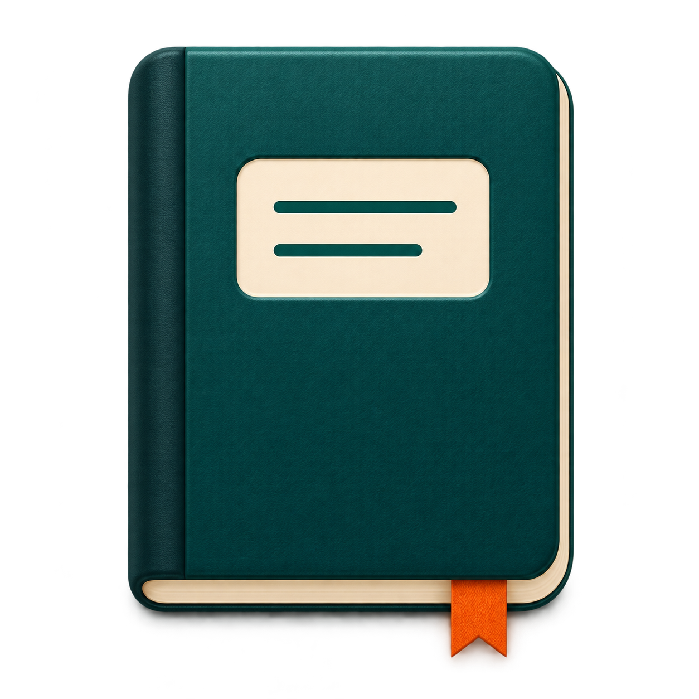

# MyNotebook



用 [egoist/mygo](https://github.com/egoist/mygo) Native UI 编写的轻量 Markdown 桌面软件，支持 macOS / Windows / Linux。界面由 Go 原生组件绘制，不使用 HTML、JavaScript 或 WebView。

## 功能

- 同时打开多个本地文件夹，文件夹和子目录均可折叠，整个侧栏可隐藏、拖动调整宽度。
- 文件树右键新建文件/文件夹、重命名、移动、删除到系统废纸篓、在系统文件管理器中显示；拖动文件或文件夹到目标目录整理，同名目标不会覆盖。跨磁盘移动暂不支持。
- 多标签笔记，创建、打开、保存、另存为、重新载入 Markdown 文件；标签右键关闭其他、关闭右侧、重新打开刚关闭的笔记，批量关闭保留未保存提示。
- 文内查找、循环定位、单次替换和全部替换，支持中文；工具栏快捷插入 Markdown 链接、图片网址或本地图片路径，替换与插入均可撤销。
- 原生文本编辑，支持中文输入法、选择、撤销/重做和标准剪贴板操作。
- 原生 Markdown 预览，支持标题、列表、任务列表、表格、代码块及本地图片；可切换编辑、预览、分屏。
- 粘贴剪贴板图片：先保存笔记，然后使用 Cmd/Ctrl+V。图片保存在笔记同目录的 `.assets/` 下，自动插入相对路径，同一图片自动去重。普通文本照常粘贴。
- 全局搜索所有工作区文件夹内已保存的 Markdown 内容，点击结果跳到对应行。后台搜索支持取消，最多显示 500 条结果。
- 自动监听工作区与单独打开的文件：外部新增、删除、改名会刷新文件树；未编辑笔记自动载入外部修改，有未保存内容时保留缓冲区并提示冲突，保存时继续检查版本。关闭未保存的笔记或退出应用时提供保存提示。
- 原生设置页：主题、编辑字号、自动换行、默认编辑/预览模式，设置自动保存。
- GitHub Releases 更新：自动或手动检查、显示更新说明、下载并验证 Ed25519 签名，确认后重启，重启前保护未保存笔记。
- 记住工作区文件夹、最后打开的文件和侧栏宽度；支持跟随系统或单独选择浅色/深色主题。

## 运行

需要 Go 1.27.3 或更新版本。Go 开启自动工具链下载时会按 `go.mod` 获取对应版本。原生项目不需要 Node.js、npm 或 Bun。

```sh
go run .
```

也可以使用 MyGo 开发模式，修改 Go 代码后自动重启：

```sh
go tool mygo dev
```

## 构建

```sh
# 当前系统的应用及安装包
go tool mygo build

# macOS Apple Silicon 和 Windows x64
go tool mygo build -platform darwin/arm64,windows/amd64

# macOS 通用版（Apple Silicon + Intel）
go tool mygo build -platform darwin/universal
```

输出在 `build/`。macOS 输出 `.app` 和 `.dmg`；Windows 输出 `.exe`，安装 NSIS（`makensis`）后还可生成安装程序。发布给其他用户前需自行配置代码签名与 macOS 公证。Windows 版本使用 Native UI，不依赖 WebView2。

应用图标位于 `resources/icon.png`，由 `mygo.json` 的 `icon` 字段指定。MyGo 构建时会自动生成 macOS、Windows 和 Linux 所需的图标尺寸与格式。

## GitHub Actions 与版本发布

- `CI`：推送 `main` 或提交 PR 时，在 Ubuntu、macOS、Windows 上运行格式检查、静态检查、竞态测试与编译，并校验工作流及打包脚本。
- `Release`：手动运行会构建产物，不发布版本；推送 `v*` tag 才会发布 GitHub Release。tag 必须与 `mygo.json` 的 `version` 对应。
- 发布前运行测试；所有平台成功后统一上传安装包、签名更新压缩包、更新清单和 `SHA256SUMS`。预发布 tag 会标记为 prerelease，稳定版更新不会安装它。
- 平台覆盖 macOS arm64 / amd64、Windows amd64 / arm64、Linux amd64 / arm64。Linux 生成 `.deb`、`.rpm` 和 `.tar.gz`，Windows 生成 NSIS 安装程序，macOS 生成 DMG。

更新签名公钥保存在 `mygo.json`。私钥已配置为仓库 Secret `MYGO_UPDATER_PRIVATE_KEY`，不在源码中。发布不需要个人访问令牌，工作流使用 GitHub 自带的 token。

发布时先修改 `mygo.json` 的版本号并提交，再推送同名 tag，例如版本 `0.1.0`：

```sh
git tag v0.1.0
git push origin v0.1.0
```

应用从 `wynemo/mynotebook` 最新稳定 Release 获取对应架构的更新；安装前验证签名，下载完成后由用户决定重启。自动检查在启动 10 秒后进行，此后每天一次，可在设置中关闭。更新不上传笔记。开发运行无法自更新；Linux 系统包由包管理器维护，便携版需安装在可写目录才能应用内更新。

Linux 上可以用 `sudo apt install ./mynotebook_版本_amd64.deb` 或 `sudo dnf install ./mynotebook-版本-1.x86_64.rpm` 安装，包管理器会处理 GTK 3 依赖；不需要 WebView。macOS 包目前使用临时签名，Windows 安装包没有厂商代码签名；签名更新文件与系统代码签名是两回事。

## 快捷键

| 操作 | macOS | Windows |
| --- | --- | --- |
| 新建笔记 | Cmd+N | Ctrl+N |
| 打开文件 | Cmd+O | Ctrl+O |
| 添加文件夹 | Cmd+Shift+O | Ctrl+Shift+O |
| 保存 | Cmd+S | Ctrl+S |
| 另存为 | Cmd+Shift+S | Ctrl+Shift+S |
| 关闭笔记 | Cmd+W | Ctrl+W |
| 重新打开关闭的笔记 | Cmd+Shift+T | Ctrl+Shift+T |
| 文内查找 / 替换 | Cmd+F | Ctrl+F |
| 插入链接 | Cmd+K | Ctrl+K |
| 隐藏/显示侧栏 | Cmd+B | Ctrl+B |
| 全局搜索 | Cmd+Shift+F | Ctrl+Shift+F |
| 切换编辑/预览/分屏 | Cmd+E | Ctrl+E |

## 验证

```sh
go test ./...
go test -race ./...
go vet ./...

# 可选：离屏渲染原生界面的浅色/深色截图
MYNOTEBOOK_SCREENSHOTS=/tmp/mynotebook-screenshots go test -run TestNativeScreenshots -v .
```

测试覆盖文件读写冲突、Unicode 搜索、搜索取消与结果上限、图片附件去重、符号链接边界、工作区恢复，以及真实原生组件的输入、预览、保存提示、标签、侧栏和图片插入撤销。

## 当前边界

文件使用 UTF-8 编码，单篇文档上限 8 MiB。全局搜索只检索 `.md`、`.markdown`、`.mdown`，跳过隐藏目录、符号链接和 `node_modules`。外部变更自动同步，也可使用侧栏“刷新”和笔记“重新载入”。关闭的笔记最多保留最近 30 个，仅在当前会话中可恢复。本地图片插入引用原路径，不自动复制附件；移动笔记时需留意相对图片路径。未保存的标签只在当前会话中保留，退出时需保存或明确放弃。

macOS 构建与原生界面自动测试已在本地验证，Linux 两种架构的 DEB、RPM 和更新压缩包已完成交叉构建。CI 会在三个系统上执行原生组件测试；跨平台打包不等同于实际桌面安装验证。
